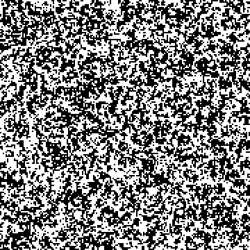
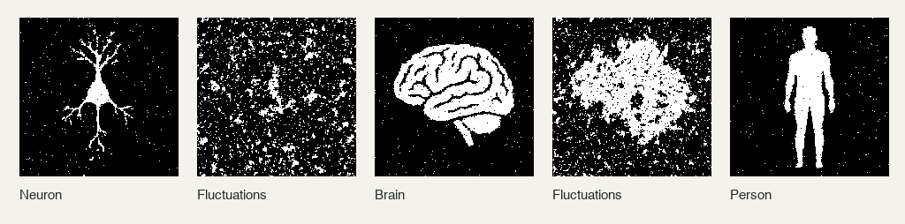
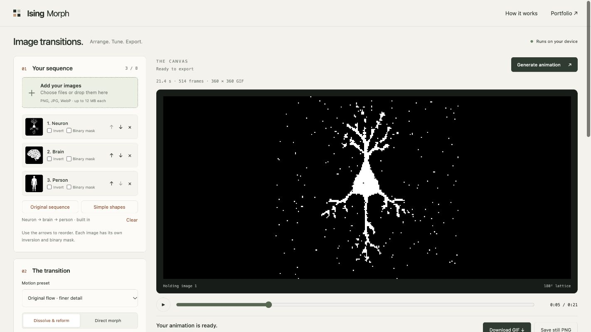

# Ising Morph

**Make images emerge, dissolve, and reform through an Ising lattice.**

A small browser studio for black-and-white animations and still figures.
Start with neuron → brain → person, or build a sequence from your own images.

**[Open the studio ↗](https://drknwmn.github.io/IsingMorph/)** ·
[Usage guide](docs/usage.md) · [Model & interpretation](docs/model.md)

<p align="center">
  
</p>
<p align="center"><sub>Original sequence · 180 × 180 lattice · seed 7 · 24 fps · browser export</sub></p>

## Try the original effect

1. **[Open the app](https://drknwmn.github.io/IsingMorph/).** Neuron, brain, and
   person are already loaded with **Original flow** settings. No upload needed.
2. Click **Generate animation**. Computation and GIF encoding run on your device.
3. Play or scrub the result. **Download GIF**, or select a frame and **Save still PNG**.

The **Original sequence** button reloads the images and restores the tuned
settings, including seed 7. **Simple shapes** loads circle → star → heart and
keeps your current animation settings. Try **Quick preview** for faster iteration.



## Make your own

Add PNG, JPG, or WebP files, then use the arrows to set their order.
Silhouettes, bold diagrams, and high-contrast figures work best.

| Control | What it changes |
| --- | --- |
| **Dissolve & reform** | Releases each image into fluctuations before the next forms. |
| **Direct morph** | Shifts the guiding field directly between images. |
| **Formation / hold / dissolve** | Sets the pace of the animation. |
| **Invert / binary mask** | Makes dark-on-light or low-contrast images easier to read. |
| **Grid / image guidance** | Adjusts simulation detail and how strongly the image forms. |
| **Save / load settings** | Keeps a recipe with the seed, timings, image names, and treatment. |

GIFs use the chosen pixel scale; still PNGs export at 1024 × 1024.
Increasing export scale enlarges pixels without adding simulation detail.
Settings files contain no images: keep your original files too.
[Read the usage guide](docs/usage.md) for thin-line images, reproducibility, and limits.



## Scope

Designed for making figures, exploring image transitions, and illustrating
Ising-like dynamics. The app uses a seeded, two-dimensional nearest-neighbor
Ising model with Metropolis updates and an image-guided spatial field.

These are finite-size, nonequilibrium visualizations. An image appearing is
not evidence of a thermodynamic phase transition, and simulation steps are
not physical time. The anatomy examples are illustrations, not neuroscience data.
[Model details and interpretation](docs/model.md).

The project stays focused: black-and-white GIF and PNG output, up to eight
images, and 64–256 pixel simulation grids. Photos may need a binary mask;
very thin lines may disappear at small grids. Longer, larger runs take more time
and are capped to fit browser memory.

## Privacy & hosting

Your selected images, simulation, and exports stay in the browser tab.
There are no accounts, API keys, analytics, model services, or image-upload
endpoints. Reloading clears the session; download results you want to keep.
The bundled examples are served with the app, and GitHub receives ordinary
page and asset requests.

This is a static site on **GitHub Pages**. A **Web Worker** runs the simulation
and GIF encoder on the visitor's device while the interface stays responsive.
It needs no backend or paid hosting service. Cancel stops an in-progress run.

## Run locally

Node.js 22 or later:

```sh
npm ci
npm test
npm run dev
```

```sh
npm run build
npm run preview
```

Deploy the generated `dist/` folder to a static host. Relative asset paths work
under `/IsingMorph/` and other project subdirectories. The
[Pages workflow](.github/workflows/pages.yml) tests, builds, and deploys pushes
to `main`; pull requests run checks without deployment.

## Credits

By [Derek Newman](https://drknwmn.github.io/portfolio/).
Code: [MIT](LICENSE). GIF encoding: [gifenc](https://github.com/mattdesl/gifenc).
[Software notices](THIRD_PARTY_NOTICES.md) ·
[Original example images and figure provenance](docs/example-assets.md).
